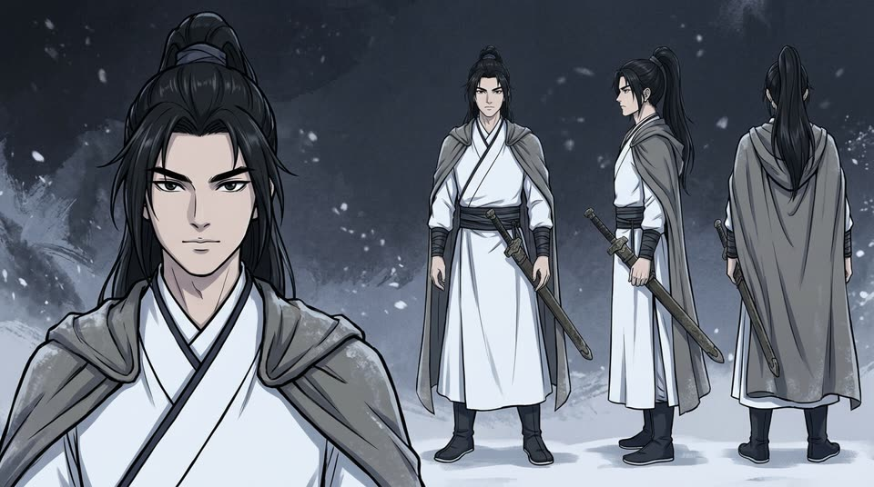

# ai-short-drama

[English](#english) · [中文](#中文)

<a id="english"></a>

**ai-short-drama is an open-source Agent Skill that turns a story into a
finished short-drama episode.** The same characters appear in every shot, they
speak their lines or a narrator tells the story, and you get subtitles and one
MP4 at the end. It runs inside Claude Code, Cursor, Codex, Gemini CLI and other
agents that read skills. Generation goes through [apimodels.app](https://apimodels.app):
one API key covers Seedance 2.0 for video, Nano Banana for character sheets and
MiniMax for the voice-over.

*Disclosure: this skill is built and maintained by the apimodels.app team.
Running it uses an apimodels.app API key and is billed per generation.*

```
You:   Make a one-minute anime short drama: a courier delivers a letter
       to an old woman on a rainy night. Vertical, with subtitles.
Agent: Wrote 12 shots, 3 characters, 2 locations (dialogue mode).
       Estimate: $1.46 at dreamina-seedance-2-0-mini 480p. Go ahead?
You:   yes
Agent: ▸ cast — here are the character sheets. Happy with them?
       ▸ shots — rendering 12 shots…
       ✓ the-last-delivery.mp4 + the-last-delivery.srt
```

### A real run

This is a one-shot test of a Chinese narrated project (国漫 style, 9:16, 480p),
using one character sheet, one line of narration and one 5-second shot. The
output below is unedited:

```
$ node scripts/drama.mjs cast project.json
▸ linfeng: generating character reference (nano-banana-2-1 1K)
✓ linfeng: cast/linfeng.jpeg  ($0.021)
$ node scripts/drama.mjs voice project.json
✓ s1: 3.6 s of narration → shot will be 5 s  ($0.004)
$ node scripts/drama.mjs shots project.json
▸ s1: 5 s, 1 reference(s)
✓ s1: shots/s1.mp4 in 185 s  ($0.108)
$ node scripts/drama.mjs assemble project.json --burn-subs
✓ snow-lantern-test.mp4  (5.1 s, 1 shots)
  spent on this project: $0.133
```

The character sheet `cast` produced, and one frame per second from the
finished shot. The shot uses the sheet as its reference, and the subtitles are
burned in:




## How it works

```
project.json ─ estimate ─ cast ─ (voice) ─ shots ─ assemble ─▶ episode.mp4 + .srt
```

1. **Your agent writes `project.json`** from your idea. It holds the
   characters, the locations and a shot list with dialogue or narration.
2. **`cast`** generates one reference sheet per character (a portrait plus
   front, side and back views) and one image per location. You review them
   before anything expensive happens.
3. **`voice`** (narration mode) synthesizes the voice-over. Each shot's
   length then follows its narration.
4. **`shots`** renders every shot with Seedance 2.0. It passes in the sheets of
   the characters in that shot and states which image is which character. That
   is what keeps faces and outfits the same from shot to shot.
5. **`assemble`** uses ffmpeg to normalize the clips, mix the narration over
   the ambient sound, join everything and write an `.srt`. Add `--burn-subs`
   to get a copy with the subtitles burned in.

**Safe to interrupt.** Every task id is written to `project.json` as soon as it
exists. Re-running a command picks up in-flight renders instead of paying for
them again. Finished shots are skipped, and failed tasks are never charged.

## Install

You need Node.js 18+ and ffmpeg (`brew install ffmpeg` /
`sudo apt install ffmpeg` / `winget install ffmpeg`).

**With the [Skills CLI](https://skills.sh/)** (Claude Code, Cursor, Codex,
Cline, Gemini CLI and more):

```bash
npx skills add stimQQ/ai-short-drama
```

**Manually:**

```bash
git clone https://github.com/stimQQ/ai-short-drama ~/.claude/skills/ai-short-drama
```

**API key:** the first time, your agent runs `drama.mjs login`. That opens
apimodels.app, you click **Authorize**, and a key is saved to
`~/.apimodels/credentials`; it never enters the chat. You can also set
`APIMODELS_API_KEY`. Keys: https://apimodels.app/console/api-keys

## What it costs

You pay per generation, at list price. A typical one-minute episode is 12 shots
of 5 seconds and 5 reference sheets:

| Video model | Resolution | ≈ one-minute episode |
|---|---|---|
| `dreamina-seedance-2-0-mini` (stylised: anime, comic, 国漫) | 480p | $1.46 |
| `dreamina-seedance-2-0-mini` | 720p | $2.99 |
| `seedance-2.0-mini` (photoreal people) | 480p | $2.75 |
| `seedance-2.0` | 1080p | $29.63 |

`estimate` prints the cost of your actual project before you spend anything.
`status` prints the exact amount billed so far, read back from the API.

## Commands

```bash
node scripts/drama.mjs check                      # key, balance, ffmpeg
node scripts/drama.mjs estimate project.json      # validate + price, free (--prompts shows every prompt)
node scripts/drama.mjs cast     project.json      # reference images (--redo <id> to regenerate one)
node scripts/drama.mjs voice    project.json      # narration mode
node scripts/drama.mjs shots    project.json      # --only s1 · --redo s3 · --retry-failed
node scripts/drama.mjs assemble project.json      # --burn-subs
node scripts/drama.mjs status   project.json
```

Two complete projects live in [`examples/`](examples/): an English dialogue
scene and a Chinese narrated 漫剧. The file format is documented in
[`references/project-schema.md`](references/project-schema.md), and
[`references/shot-writing.md`](references/shot-writing.md) explains how to
write shots that cut together.

## Limits

- **Consistency is strong, not perfect.** Faces can drift in wide shots and
  when three or more characters share a frame. The skill keeps shots to one or
  two characters for this reason.
- **Each shot is 4–15 seconds.**
- **Dialogue voices are generated per shot**, so a character can sound a
  little different from shot to shot. Narration mode uses one voice for the
  whole episode.
- **Subtitle timings are spread evenly within each shot.** They are close,
  not frame-exact.
- **Not for real, identifiable people** without their consent.
- **Not for lip-syncing to a voice track you recorded.**

## Development

```bash
pnpm test        # offline: no key, no network, no spend (ffmpeg needed for the assemble test)
```

MIT licensed.

---

<a id="中文"></a>

## 中文

**ai-short-drama 是一个开源 Agent Skill，把一段故事变成一集完整的短剧 / AI 漫剧。**
每个镜头里的角色保持同一张脸、同一套衣服；可以让角色开口说台词，也可以用旁白讲故事。最后输出一个 MP4 和一份字幕。
它在 Claude Code、Cursor、Codex、Gemini CLI 等支持 skill 的 Agent 里运行，生成走 [apimodels.app](https://apimodels.app)：
一个 API Key 同时用 Seedance 2.0 出视频、Nano Banana 出角色设定图、MiniMax 配旁白。

*说明：本 skill 由 apimodels.app 团队开发维护，运行时使用 apimodels.app 的 API Key，按次计费。*

**流程：**
1. Agent 根据你的想法写 `project.json`（角色、场景、分镜、台词或旁白）。
2. `cast` 给每个角色生成一张设定图（大头像加正、侧、背三视图），给每个场景生成一张场景图。先给你看，满意了再往下走。
3. `voice`（旁白模式）合成旁白，镜头时长自动跟着旁白长度走。
4. `shots` 用 Seedance 2.0 逐镜头渲染，并按位置把设定图对应到角色（图片1 是谁、图片2 是谁）。角色在各镜头之间不走样，靠的就是这一步。
5. `assemble` 用 ffmpeg 统一尺寸、混入旁白、拼接，并生成 `.srt`；加 `--burn-subs` 会另出一份压好字幕的版本。

**中途断了不会重复扣费。** 任务一创建，任务 id 就写进 `project.json`。重跑命令时，还在渲染的镜头接着等，已完成的跳过；失败的任务不扣费。

**安装：** 需要 Node.js 18+ 和 ffmpeg。

```bash
npx skills add stimQQ/ai-short-drama
```

第一次使用时，Agent 会运行 `drama.mjs login` 打开 apimodels.app。你点一下 **Authorize**，Key 会存到本机 `~/.apimodels/credentials`，不会出现在对话里。

**费用：** 按次计费，按标价。一集 1 分钟（12 个 5 秒镜头、5 张设定图）大约：
- 动漫 / 国漫风格，`dreamina-seedance-2-0-mini`：480p $1.46，720p $2.99
- 写实真人风格，`seedance-2.0-mini`：480p $2.75

开工前 `estimate` 会按你的项目算出总价；`status` 显示从 API 回读的实际扣费。实测一个国漫风格的单镜头项目（1 张角色设定图、1 句旁白、1 个 5 秒镜头），实际扣费合计 $0.133，截图见英文部分的 “A real run”。

**对白还是旁白：** 漫剧、小说改编、故事解说，用旁白模式（全集同一个声音）；靠对话推进的戏，用对白模式（角色开口、口型同步，但同一角色在不同镜头里的声音可能略有差异）。

**限制：** 一致性很好，但不是 100%：远景、或同框三人以上时，脸可能走样，所以每个镜头尽量只放 1 到 2 个角色。单个镜头 4 到 15 秒。字幕时间是镜头内平均分配的近似值。不用于未经本人同意的真实人物。不支持对口型到你自己录的音轨。

示例在 [`examples/`](examples/)：英文对白 + 中文旁白漫剧各一个。格式说明见 [`references/project-schema.md`](references/project-schema.md)，分镜写法见 [`references/shot-writing.md`](references/shot-writing.md)。
